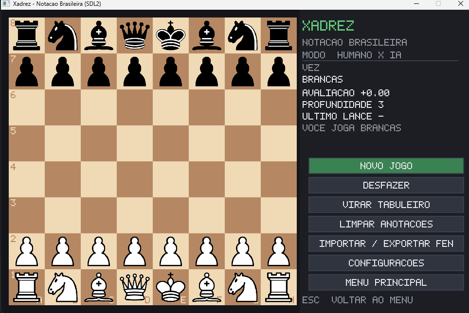

# Guia de comandos para o Claude

Esta página mostra **um exemplo de cada formatação** que o Claude sabe fazer. Você escreve o texto de forma simples e coloca um **comando** antes, dizendo como ele deve ficar.

!!! info "Como funciona um comando"
    - O comando começa com `\claude` e termina com `\`. Exemplo: `\claudeTabela\`
    - Ele vale para o texto **logo abaixo dele, até a próxima linha em branco**.
    - Alguns comandos recebem informações dentro deles, separadas por espaço. Exemplo: `\claudeVideo https://www.youtube.com/watch?v=...\`
    - Para pedir qualquer outra coisa, escreva normalmente: `\claude deixe esse parágrafo em negrito\`

Em cada exemplo abaixo, a primeira parte é **o que você escreve** e a segunda é **como fica no site**.

---

## Resumo dos comandos

| Comando | O que faz |
| ------- | --------- |
| `\claudeTabela\` | Transforma o texto em tabela |
| `\claudeCaixa tipo\` | Cria uma caixa de destaque (`dica`, `info`, `atencao`, `perigo`, `exemplo`) |
| `\claudeResposta\` | Cria uma caixa escondida que abre ao clicar |
| `\claudeImagem nome-do-arquivo\` | Insere uma imagem da pasta `docs/assets` |
| `\claudeVideo link\` | Insere um miniplayer do YouTube |
| `\claudeProgresso\` | Insere a barra de progresso das atividades |
| `\claudeQuiz\` | Cria uma pergunta de múltipla escolha |
| `\claudeLance\` | Cria um tabuleiro "encontre o melhor lance" |
| `\claudeLichess\` | Insere o Puzzle do Dia do Lichess |
| `\claude ...\` | Qualquer outro pedido, escrito do seu jeito |

---

## Tabela

Separe as colunas com espaços. A primeira linha é o cabeçalho.

**Você escreve:**

```text
\claudeTabela\
Peça        Valor
Peão        1
Cavalo      3
Torre       5
```

**Resultado:**

| Peça   | Valor |
| ------ | ----- |
| Peão   | 1     |
| Cavalo | 3     |
| Torre  | 5     |

---

## Caixa de destaque

A primeira linha é o título da caixa, o resto é o texto.

**Você escreve:**

```text
\claudeCaixa dica\
Lembre do roque
Proteja o rei fazendo o roque nos primeiros lances.
```

**Resultado:**

!!! tip "Lembre do roque"
    Proteja o rei fazendo o roque nos primeiros lances.

---

## Resposta escondida

A primeira linha é a pergunta, o resto é a resposta, que só aparece ao clicar.

**Você escreve:**

```text
\claudeResposta\
Por que o Rei não possui valor em pontos?
Porque o objetivo do jogo é dar xeque-mate no Rei.
```

**Resultado:**

**Por que o Rei não possui valor em pontos?**

??? success "Ver resposta"
    Porque o objetivo do jogo é dar xeque-mate no Rei.

---

## Imagem

Salve a imagem na pasta `CursoXadrez/docs/assets` (nome sem espaços e sem acentos). A linha abaixo do comando é a descrição da imagem.

**Você escreve:**

```text
\claudeImagem mate-escadinha.png\
Mate escadinha
```

**Resultado:**



---

## Vídeo (miniplayer)

Basta colar o link do YouTube dentro do comando. A linha abaixo é o nome do vídeo.

**Você escreve:**

```text
\claudeVideo https://www.youtube.com/watch?v=uuUdAa_2GDM\
Mate escadinha
```

**Resultado:**

<div align="center">

<iframe
width="720"
height="405"
src="https://www.youtube.com/embed/uuUdAa_2GDM"
title="Mate escadinha"
frameborder="0"
allowfullscreen>
</iframe>

</div>

---

## Barra de progresso

Mostra quantas atividades da página o aluno já concluiu. Coloque antes dos exercícios.

**Você escreve:**

```text
\claudeProgresso\
```

**Resultado:**

<div class="progresso-atividades"></div>

---

## Pergunta de múltipla escolha

A primeira linha é a pergunta. As alternativas vêm abaixo com **4 espaços**. Embaixo de cada alternativa, com **8 espaços**, escreva `Certo` ou `Errado:` e o motivo do erro.

**Você escreve:**

```text
\claudeQuiz\
Quanto vale uma torre?
    3 pontos
        Errado: 3 pontos é o valor do cavalo e do bispo.
    5 pontos
        Certo
    9 pontos
        Errado: 9 pontos é o valor da dama.
```

**Resultado:**

<div class="quiz" markdown>

**Quanto vale uma torre?**

- [ ] 3 pontos

    > 3 pontos é o valor do cavalo e do bispo.

- [x] 5 pontos
- [ ] 9 pontos

    > 9 pontos é o valor da dama.

</div>

---

## Encontre o melhor lance

Escreva a posição em FEN (no Lichess: *Ferramentas › Editor de tabuleiro*, campo "FEN") e a solução com a casa de origem e a de destino de cada lance.

**Você escreve:**

```text
\claudeLance\
Mate no corredor (brancas jogam)
fen: 6k1/5ppp/8/8/8/8/5PPP/3R2K1 w - - 0 1
solucao: d1d8
```

**Resultado:**

### Mate no corredor (brancas jogam)

<div class="puzzle"
     data-fen="6k1/5ppp/8/8/8/8/5PPP/3R2K1 w - - 0 1"
     data-solucao="d1d8"></div>

---

## Puzzle do Dia do Lichess

Um exercício que muda todos os dias, direto do Lichess.

**Você escreve:**

```text
\claudeLichess\
```

**Resultado:**

<div align="center">

<iframe
class="lichess-puzzle"
src="https://lichess.org/training/frame?theme=brown&bg=light"
title="Puzzle do Dia do Lichess"
loading="lazy"
frameborder="0">
</iframe>

</div>

---

## Pedido livre

Se não houver um comando pronto, escreva o que você quer com suas palavras.

**Você escreve:**

```text
\claude deixe a palavra xeque-mate em negrito\
O objetivo do jogo é dar xeque-mate no rei adversário.
```

**Resultado:**

O objetivo do jogo é dar **xeque-mate** no rei adversário.
