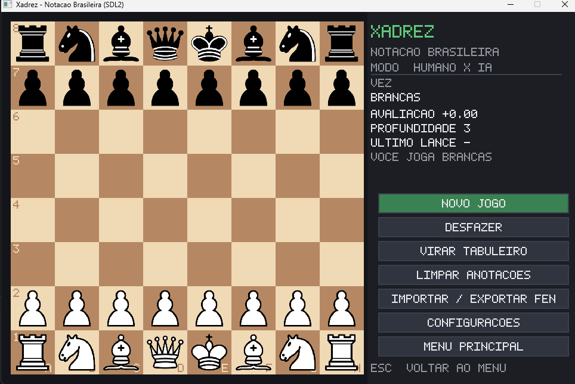

# Mates conhecidos

No xadrez, é muito importante reconhecer padrões. Para isso, vamos treinar os mates que se repetem muito.

!!! warning "Não decore, aprenda"
    É importante você entender como esses mates funcionam. Apenas decorar os lances não faz sentido, pois, se a posição for minimamente diferente, você não conseguirá reproduzir.

| Mate            | Dificuldade |
| --------------- | ----------- |
| Escadinha       | Fácil       |
| Mate do pastor  | Fácil       |
| Mate de Philidor | Difícil    |

## Mate escadinha

O mate escadinha é um dos mais fáceis e conhecidos do xadrez. Nos níveis mais iniciantes, ele se repete muito.

<iframe
width="720"
height="405"
src="https://www.youtube.com/embed/uuUdAa_2GDM"
title="Mate escadinha"
frameborder="0"
allowfullscreen>
</iframe>

### Exercícios

**O que devo fazer para dar mate?**

- [ ] Falar xeque sempre que puder

    > O jogador não é obrigado a avisar o xeque.

- [x] Reconhecer padrões e tentar cercar o rei
- [ ] Acabou a criatividade

    > kkkkk

## Fim! Parabéns, você finalizou a tarefa. Se quiser melhorar, analise essa partida

<iframe
class="lichess-puzzle"
src="https://lichess.org/training/frame?theme=brown&bg=light"
title="Puzzle do Dia do Lichess"
loading="lazy"
frameborder="0">
</iframe>

